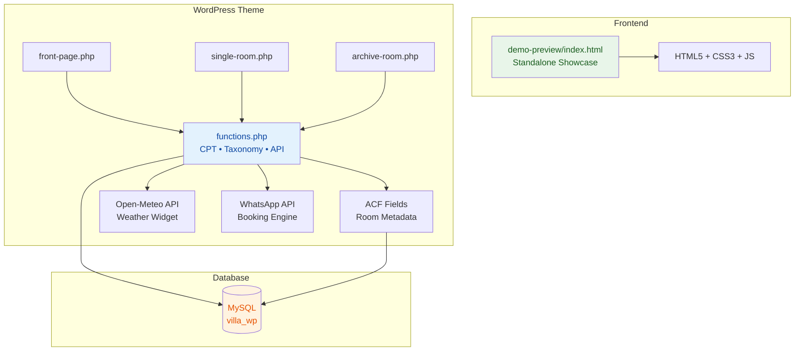

# 🏛️ Villa Galle Fort — Luxury Sri Lankan Boutique Villa Website


A bespoke, full-stack WordPress hospitality website built for a luxury Sri Lankan coastal villa in Galle Fort. Features a custom Astra child theme, custom post types, ACF integration, real-time weather API, direct WhatsApp booking, and a stunning standalone interactive showcase.

Designed specifically to match the hospitality and tourism clientele of agencies like **Smart eWorks**.


---

## 🖼️ Preview

| Hero Section | Suites Showcase | Gallery Lightbox |
|:---:|:---:|:---:|
| Cinematic full-screen hero with animated tagline | 4 luxury suites with specs & pricing in Rs. | Masonry gallery with smooth lightbox overlay |

> 💡 **Live Demo:** Open [https://drive.google.com/file/d/1PQIClkm6jfN3FNOXzydS6x-lwpCx8U-w/view?usp=sharing] in any browser to view the full interactive showcase without a WordPress installation.

---

## 🌟 Features

### 🏨 Accommodation Management
- ✅ Custom Post Type (`room`) & Taxonomy (`room_category`) — coded in `functions.php`
- ✅ Custom admin columns for Price/Night, Max Occupancy, and Bedding
- ✅ ACF-powered metadata: Nightly Price (Rs.), Max Guests, Bed Config, Room Size, View, Amenities
- ✅ JSON ACF field group export for 1-click import

### 🎨 Design & User Experience
- ✅ Cinematic full-screen hero with animated gradient overlay
- ✅ Heritage story section with accreditation badges
- ✅ 4 luxury suite cards with detailed specifications
- ✅ Masonry photo gallery with smooth lightbox
- ✅ Curated Ceylon Experiences showcase
- ✅ Whole Villa Buyout exclusive booking section
- ✅ Responsive design — mobile, tablet & desktop optimized
- ✅ Micro-animations, hover effects & glassmorphism elements

### 📱 Booking & Communication
- ✅ Direct WhatsApp Booking Engine with floating pulse widget
- ✅ Context-aware messaging: pre-populates room name & price
- ✅ Quick Availability Search Bar with date pickers
- ✅ Direct Reservations Form with WhatsApp Concierge integration

### 🌤️ API Integrations
- ✅ Live Weather Widget (`[galle_weather]` shortcode)
- ✅ Real-time temperature, condition & humidity from Open-Meteo API
- ✅ WordPress Transients API (2-hour caching) for 0ms page load impact
- ✅ GPS coordinates: Galle Fort (`6.0535° N, 80.2210° E`)

### ⚡ Performance & SEO
- ✅ Optimized CSS with CSS custom properties (design tokens)
- ✅ Lazy-loaded images for fast page loads
- ✅ Semantic HTML5 structure
- ✅ SEO-friendly meta tags and heading hierarchy

---

## 🛠️ Tech Stack

| Layer | Technology |
|-------|-----------|
| **CMS** | WordPress 6.x |
| **Parent Theme** | Astra |
| **Child Theme** | Custom `astra-villa-child` |
| **Backend** | PHP 8.0+ |
| **Frontend** | HTML5, CSS3, JavaScript (ES6+) |
| **Database** | MySQL 8.0 / MariaDB |
| **Custom Fields** | Advanced Custom Fields (ACF) |
| **Weather API** | Open-Meteo REST API |
| **Icons** | Font Awesome 6 |
| **Fonts** | Google Fonts (Playfair Display, Cormorant Garamond, Inter) |
| **Server** | Apache (XAMPP / LAMP) |
| **Showcase** | Standalone HTML/CSS/JS interactive preview |

---

## 📁 Project Directory Structure

```text
sri-lanka-villa-wordpress/
├── astra-villa-child/                    # 🎨 Custom WordPress child theme
│   ├── style.css                         # Theme headers & CSS variables
│   ├── functions.php                     # CPT, taxonomy, weather API, WhatsApp hooks
│   ├── front-page.php                    # Custom homepage template
│   ├── single-room.php                   # Individual room detail template
│   ├── archive-room.php                  # Rooms listing / archive template
│   ├── acf-json/                         # ACF local JSON sync
│   └── assets/
│       ├── css/
│       │   └── villa-custom.css          # Luxury resort design system (19 KB)
│       ├── js/
│       │   └── villa-custom.js           # Date validation & query param pre-fills
│       └── images/                       # Theme image assets
│
├── demo-preview/                         # 🖥️ Standalone interactive showcase
│   ├── index.html                        # Full merged showcase (91 KB)
│   └── images/                           # Showcase imagery
│       ├── hero-villa.jpg                # Cinematic hero background
│       ├── galle-fort.jpg                # Heritage section
│       ├── suite-master.jpg              # Dutch Galle Master Suite
│       ├── suite-garden.jpg              # Kandyan Garden Plunge Villa
│       ├── suite-ocean.jpg               # Lighthouse Ocean Horizon Suite
│       ├── suite-courtyard.jpg           # Ceylon Cinnamon Courtyard Room
│       ├── spa-pool.jpg                  # Spa & pool imagery
│       └── dining.jpg                    # Dining experience
│
├── acf-export/
│   └── acf-room-fields.json             # 1-click ACF field group import
│
├── database/
│   └── sample-rooms-seed.sql            # 4 pre-configured Sri Lankan luxury suites
│
├── wp-config.php                         # WordPress configuration
├── install-setup.php                     # Automated setup script
├── .htaccess                             # Apache rewrite rules
├── .gitignore                            # Git ignore rules
└── README.md                            # 📖 This documentation
```

---

## 🚀 Setup & Installation

### Prerequisites
- **XAMPP** (or any LAMP/WAMP stack) with Apache & MySQL running
- **PHP 8.0+**
- **WordPress 6.x** installed locally
- **Astra Theme** (free version) installed as parent theme

### Step 1 — Database & Local Setup
1. Open XAMPP Control Panel → Start **Apache** and **MySQL**
2. In phpMyAdmin (`http://localhost/phpmyadmin/`), create or verify the database `villa_wp`
3. Access your WordPress site at `http://localhost/villa_wp/`

### Step 2 — Activate the Child Theme
```bash
# Copy child theme to WordPress themes directory
cp -r astra-villa-child/ /path/to/wordpress/wp-content/themes/astra-villa-child/
```
1. In WordPress Admin → **Appearance → Themes** → Activate **Villa Galle Fort - Astra Child**
2. Go to **Settings → Permalinks** → Select **Post name** (`/%postname%/`) → **Save Changes**

### Step 3 — Import Custom Fields (ACF)
1. Install and activate the free **Advanced Custom Fields** plugin
2. Navigate to **Custom Fields → Tools → Import Field Groups**
3. Select `acf-export/acf-room-fields.json` → Click **Import JSON**
4. The "Villa Room & Suite Details" panel will appear on all Room edit screens

### Step 4 — Seed Sample Rooms
Run `database/sample-rooms-seed.sql` in phpMyAdmin, or manually create rooms in **Villa Rooms → Add New Room**:

| Suite Name | Price/Night | Max Guests |
|-----------|-------------|------------|
| The Dutch Galle Master Suite | Rs. 68,000 | 2 |
| Kandyan Garden Plunge Villa | Rs. 56,000 | 3 |
| Lighthouse Ocean Horizon Suite | Rs. 60,000 | 2 |
| Ceylon Cinnamon Courtyard Room | Rs. 42,000 | 2 |

### Step 5 — Quick Frontend Preview (No WordPress Required)
```bash
# Simply open the standalone showcase in your browser
start demo-preview/index.html
```

---

## 🏗️ Architecture



---

## 📦 Programming Languages & Technologies

| Language | Usage | Files |
|----------|-------|-------|
| **PHP** | WordPress theme templates, custom post types, REST API integration, shortcodes | `functions.php`, `front-page.php`, `single-room.php`, `archive-room.php`, `wp-config.php`, `install-setup.php` |
| **HTML5** | Page structure, semantic markup, standalone showcase | `index.html`, PHP template output |
| **CSS3** | Design system, animations, responsive layout, glassmorphism | `style.css`, `villa-custom.css`, inline styles |
| **JavaScript** | Date validation, lightbox, gallery interactions, query params | `villa-custom.js`, inline scripts in showcase |
| **SQL** | Database schema, sample data seeding | `sample-rooms-seed.sql` |
| **JSON** | ACF field group configuration export | `acf-room-fields.json` |

---

## 🤝 Contributing

1. Fork the repository
2. Create your feature branch (`git checkout -b feature/amazing-feature`)
3. Commit your changes (`git commit -m 'feat: add amazing feature'`)
4. Push to the branch (`git push origin feature/amazing-feature`)
5. Open a Pull Request

---

## 📄 License

This project is licensed under the **MIT License** — see the [LICENSE](LICENSE) file for details.

---

## 👤 Author

**Mufla Muffathi**
- GitHub: [@muflamuffathi-creator](https://github.com/muflamuffathi-creator)
- Email: fathimamufla107@gmail.com
-Portfolio:https://fathima-mufla.netlify.app/
---

## 🙏 Acknowledgements

- [WordPress](https://wordpress.org/) — Content Management System
- [Astra Theme](https://wpastra.com/) — Parent theme framework
- [Advanced Custom Fields](https://www.advancedcustomfields.com/) — Custom field management
- [Open-Meteo](https://open-meteo.com/) — Free weather API
- [Font Awesome](https://fontawesome.com/) — Icon library
- [Google Fonts](https://fonts.google.com/) — Typography (Playfair Display, Cormorant Garamond, Inter)

---

<p align="center">
  <b>🌴 Built with ❤️ for Sri Lankan Hospitality 🌴</b>
</p>
